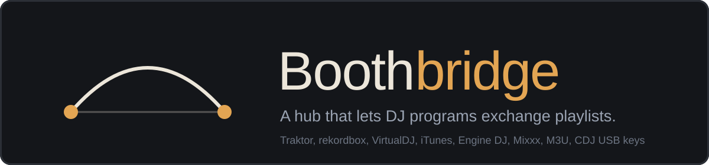
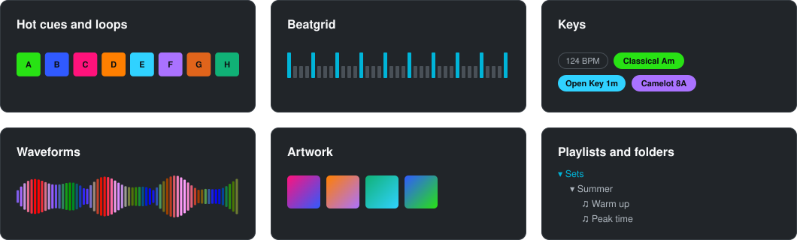

# Boothbridge

Boothbridge moves DJ playlists from one program to another. Each program keeps its collection in its own format, and the hours spent building a playlist are lost when you change program. Boothbridge reads those collections and writes them back out, with the cues, loops and beat grids it can carry across. It is not a DJ program and it does not mix. It works next to the programs it connects.

Gear that works should keep working, and a playlist should not be locked in one program. A CDJ-2000NXS2 can be loaded from a collection made in Traktor, VirtualDJ, Engine DJ or Mixxx, whichever you use today.



Reads: Traktor NML, rekordbox XML, VirtualDJ, iTunes or Music `Library.xml`, Denon Engine DJ, Mixxx, M3U and M3U8, a music folder, a CDJ USB key.

Writes: rekordbox XML, M3U8, Traktor NML, VirtualDJ lists, Mixxx, iTunes XML, CSV, JSON, PLS, XSPF, a ZIP backup, a CDJ USB key.

It also has a playlist and cue editor, beat grid detection, an ID tag editor, an audio check and a music browser. The interface is in English, French, German, Spanish and Chinese. It runs on Windows (installer and portable build), and from source on macOS and Linux.

Version 1.0.0. Boothbridge is free for personal and other noncommercial use. Companies and any commercial use: contact the author.

## Run it from source

Python 3.11 or newer:

```bash
pip install -r requirements.txt
python main.py
```

## For developers

The developer guide is [DEVELOPERS.md](DEVELOPERS.md): the architecture, how a reader and a writer are written, the languages, the build.

| Where | What it holds |
| --- | --- |
| `main.py`, `djapp/app.py` | the launcher, the start of the window and the command line |
| `djapp/brand.py` | the name, the version and the names of the files the program writes |
| `djapp/model.py` | the collection model every reader fills and every writer reads |
| `djapp/sources/` | the readers, one module per format, `detect()` and `load()` in `__init__.py` |
| `djapp/export/` | the writers, one module per format, and the checksums of an export (`manifest.py`) |
| `djapp/ui/` | the windows: `main_window.py`, `details.py` (playlist), `player.py`, `timeline.py`, `dialogs.py` |
| `djapp/tags.py`, `tagfile.py`, `tagwrite.py` | reading and writing the tags of audio files, written from the public format specifications |
| `djapp/analysis.py`, `beatdetect.py` | waveforms, tempo and first beat |
| `djapp/settings.py` | the settings, a JSON file in the data folder (`%APPDATA%\BSM\Boothbridge`, beside the program in a portable copy) |

Command line, no window:

```bash
python main.py --export COLLECTION OUTPUT --format "Rekordbox XML" [--music FOLDER]
python main.py --verify OUTPUT
```

Every source file starts with the author line and one line on what the file is for. Lines are 88
characters at most, `ruff check` and `ruff format` set the rules (`ruff.toml`). Changes are welcome
for personal and other noncommercial use, see the licence below.


## Licence and legality

[PolyForm Noncommercial 1.0.0](LICENSE): free for personal, educational and any other noncommercial use. Commercial use needs the author's prior authorisation, contact him. Third party libraries are listed in [THIRD_PARTY.md](THIRD_PARTY.md).

Boothbridge reads and writes files that other programs use, for interoperability. No program or firmware of another vendor was disassembled or copied, and the encrypted databases of other programs are never opened. This is the author's understanding of the rules in the European Union, not legal advice.

The CDJ USB key is written by Boothbridge itself. rekordbox is not needed and takes no part in it. The export uses the original Device Library format, which AlphaTheta lists for the CDJ-2000NXS2 and older models, XDJ-700, XDJ-1000MK2, CDJ-900NXS2, XDJ-XZ, XDJ-RX3, XDJ-RR and CDJ-3000. The author tested it on a CDJ-2000NXS2 only, so test your own player before a gig. Players that read only the newer OneLibrary format (CDJ-3000X, XDJ-AZ, OPUS-QUAD, OMNIS-DUO) are not supported.

Traktor and Native Instruments are trademarks of Native Instruments GmbH. rekordbox, Pioneer DJ and CDJ are trademarks of AlphaTheta Corporation. VirtualDJ is a registered trademark of Atomix Productions Inc. Denon DJ and Engine DJ are trademarks of inMusic Brands, Inc. iTunes and Apple Music are trademarks of Apple Inc. Mixxx is the name of the Mixxx open source project. Boothbridge is independent and not affiliated with or endorsed by any of them.

Boothbridge is a noncommercial project made by one person in his free time, provided as is, without warranty. Back up your collection and keep the originals of your files.

## Author

Benoit (BSM) Saint-Moulin: [benoitsaintmoulin.com](https://www.benoitsaintmoulin.com),
[bsm3d.com](https://www.bsm3d.com).
